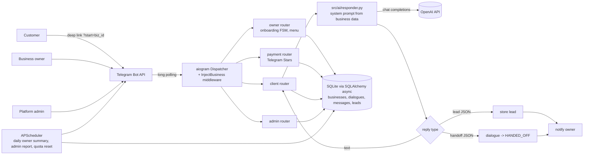

# Replly

AI sales assistant for small businesses in Telegram: the owner fills in a price list and FAQ, gets a client link, and the bot answers customers 24/7, collects bookings and hands tricky questions to a human.

## Features

- Self-service onboarding for owners: name, category, website, description, phone, address, working hours, knowledge base (prices, services, FAQ), tone of voice.
- One multi-tenant bot: every business gets its own deep link `?start=biz_<id>`; customers who open it talk to that business only.
- Answers strictly from the business knowledge base - the prompt forbids inventing prices, services or addresses.
- Lead capture: when a customer leaves a name and phone, a lead is stored and the owner gets an instant notification.
- Human handoff: if the AI can't answer, the dialogue is marked as handed off and the owner is notified with the question and the reason.
- Owner menu: stats, recent dialogues, knowledge base editing, settings, subscription, pause bot.
- Subscriptions paid with Telegram Stars (start / business / pro plans, trial period).
- Admin panel: business list, activate / pause, leads overview; daily reports via scheduler.

## Architecture



How a customer message is answered:

1. The customer opens the business link; a `Dialogue` is created (or reused) and the business greeting is sent.
2. Every incoming message is stored, the last 10 messages are loaded as context.
3. `responder.py` builds a system prompt from the business profile and knowledge base and calls the OpenAI chat completions API (short answers, customer's language, never invent facts).
4. The model either replies with plain text or returns a JSON action: `{"action": "lead", ...}` when the customer left contacts, `{"action": "handoff", ...}` when the answer is not in the knowledge base.
5. On `lead` the bot saves the lead and pings the owner; on `handoff` it sends the customer a polite "I'll check with a manager" reply, marks the dialogue as handed off (the AI stops answering it) and forwards the question to the owner, who continues with the customer directly.
6. Errors and timeouts from the model fall back to a safe holding reply, so customers never see a stack trace.

## Numbers

- 4 routers (admin, owner, payment, client), 1 middleware, 3 scheduled jobs.
- 6 database tables (businesses, dialogues, messages, leads, outreach leads, outreach logs).
- ~2.3k lines of Python.

## Tech stack

Python 3.12, aiogram 3, SQLAlchemy 2 (async) + aiosqlite, APScheduler, aiohttp, pydantic-settings, loguru, OpenAI chat completions API, Telegram Stars payments.

## Project structure

```
.
├── main.py              # entry point: DB init, scheduler, routers, long polling
├── config/settings.py   # all settings from environment / .env
├── src/
│   ├── ai/              # responder.py - prompt building, OpenAI call, action parsing
│   ├── bot/
│   │   ├── handlers/    # admin.py, owner.py, payment.py, client.py
│   │   ├── keyboards.py
│   │   └── middlewares.py  # injects the owner's Business into handlers
│   ├── db/              # async engine, models
│   ├── scheduler/       # daily summaries, admin report, quota reset
│   └── outreach/        # email sender helper with rate limit and daily quota
├── data/                # SQLite database and logs (created at runtime, git-ignored)
├── Dockerfile
└── requirements.txt
```

## Getting started

Requires a Telegram bot token and an OpenAI API key. Without the OpenAI key the bot still runs but replies with a fixed "a manager will answer soon" message.

```bash
python3 -m venv .venv && source .venv/bin/activate
pip install -r requirements.txt

cp .env.example .env
# fill BOT_TOKEN, OPENAI_API_KEY, ADMIN_IDS (your Telegram user id), SUPPORT_USERNAME, SITE_URL

python3 main.py
```

Then open your bot in Telegram, press /start and go through the onboarding as a business owner; the bot gives you the customer link at the end.

There is no automated test suite yet.

## License

MIT - see [LICENSE](LICENSE).
